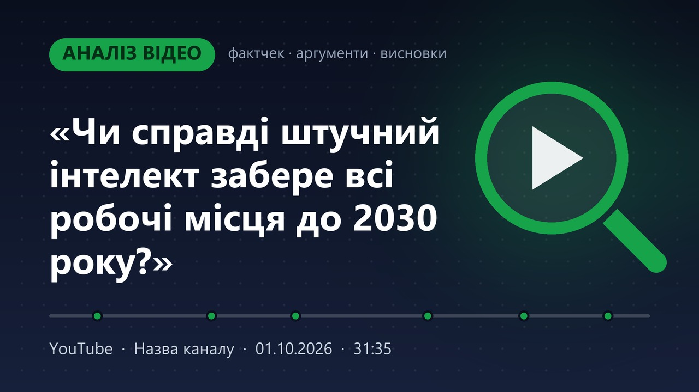

# yt2txt

Локальний інструмент для Windows: дає посилання на YouTube-відео, отримуєш Markdown-файл із транскриптом і готовим промптом для ШІ. Цей файл кидаєш у Claude (чи іншу модель) і отримуєш аналітичну статтю з фактчеком, розбором аргументації та висновками, одразу у форматі для [telegra.ph](https://telegra.ph). Також скрипт генерує обкладинку для статті.

Розпізнавання мовлення працює локально через [faster-whisper](https://github.com/SYSTRAN/faster-whisper), тож відео нікуди не відправляються. Найкраще перевірено на українській мові, також підтримуються англійська й російська.



## Що на виході

На кожне відео в папці `transcripts\` зʼявляються два файли:

**`<дата>_<назва>.md`** — у такому порядку:
1. Метадані: канал, дата, тривалість, посилання, визначена мова, модель.
2. Транскрипт у тегах `<transcript>…</transcript>`, розбитий на абзаци з таймкодами `[mm:ss]`.
3. Промпт для ШІ. Він стоїть у кінці, бо на довгих документах моделі краще виконують інструкції, що йдуть після тексту.

**`<дата>_<назва>.jpg`** — обкладинка 1280×720 для статті.

## Як працює

1. [yt-dlp](https://github.com/yt-dlp/yt-dlp) завантажує тільки аудіодоріжку.
2. faster-whisper розпізнає мовлення на GPU або CPU. Тиша й музика вирізаються (VAD), щоб модель менше «галюцинувала».
3. Сегменти склеюються в абзаци: новий абзац починається після паузи понад 2 с або кожні ~60 с.
4. Скрипт записує `.md` з промптом і генерує обкладинку.

ffmpeg не потрібен: аудіо декодується через PyAV.

## Що робить промпт

Промпт просить ШІ написати статтю для telegra.ph з такими розділами:

- **Заголовок і лід.**
- **Про що відео:** головна теза й аргументи автора.
- **Перевірка фактів:** кожне конкретне твердження з оцінкою «підтверджується / частково / не підтверджується / неможливо перевірити» і поясненням.
- **Як побудована аргументація:** логічні хиби, маніпулятивні прийоми, а також сильні сторони.
- **Чого не прозвучало:** контекст і альтернативні погляди.
- **Висновок:** оцінка довіри N/10.

Таймкоди в статті стають посиланнями на відповідний момент відео. Оформлення враховує обмеження редактора telegra.ph: без таблиць і лише два рівні заголовків.

Транскрипт автоматичний, тому промпт просить ШІ зважати на можливі помилки в іменах і числах. Після статті ШІ окремим блоком «НЕ ДЛЯ ПУБЛІКАЦІЇ» перелічує, що варто перевірити вручну.

Можна підставити свій промпт: `--prompt-file my_prompt.md`.

## Встановлення

Потрібні Windows 10/11 і Python 3.10+. Команди нижче для PowerShell у папці проєкту.

```powershell
git clone https://github.com/ivan-lutskyi/yt2txt.git
cd yt2txt
python -m venv .venv
.\.venv\Scripts\python.exe -m pip install -U -r requirements.txt
```

**Deno** — JS-рантайм, без якого yt-dlp не може повноцінно працювати з YouTube:
1. Завантаж `deno-x86_64-pc-windows-msvc.zip` з [релізів Deno](https://github.com/denoland/deno/releases). Потрібна саме збірка **x86_64**, а не `aarch64`, якщо в тебе не ARM-ноутбук.
2. Розпакуй `deno.exe` у `.venv\Scripts\`.

**GPU (необовʼязково).** Якщо є відеокарта NVIDIA, `requirements.txt` уже ставить cuBLAS і cuDNN, і скрипт сам їх підхоплює. Потрібен лише свіжий драйвер NVIDIA. Без відеокарти скрипт автоматично працює на CPU.

## Використання

### Графічний інтерфейс

Запусти `gui.bat` подвійним кліком: сторінка відкриється в браузері (http://127.0.0.1:7860). На ній можна:
- вставити одне чи кілька посилань, вибрати мову, модель і тип обкладинки, за потреби відредагувати промпт;
- стежити за прогресом розпізнавання;
- переглянути обкладинку, скопіювати вміст `.md` для Claude однією кнопкою, завантажити файли;
- відкрити будь-який попередній транскрипт зі списку результатів.

Модель лишається в памʼяті між запусками, тож наступні відео стартують одразу. Кнопка «Звільнити GPU» вивантажує її.

`gui.bat --lan` відкриває сторінку для інших пристроїв у локальній мережі, наприклад з телефона за адресою `http://<IP-компʼютера>:7860`. **Пароля немає**, тому вмикай це лише в домашній мережі.

### Командний рядок

```powershell
.\run.bat "https://youtu.be/XXXXXXXXXXX"
```

`run.bat` налаштовує середовище: моделі Whisper зберігаються в `models\` усередині проєкту, а не в профілі користувача. Під час першого запуску завантажиться модель `large-v3` (~3 ГБ).

Кілька відео за раз:
```powershell
.\run.bat "https://youtu.be/AAA" "https://youtu.be/BBB" --lang uk
```

### Параметри

| Параметр | Значення | За замовчуванням |
|---|---|---|
| `--lang` | `uk`, `en`, `ru`… | автовизначення |
| `--model` | `large-v3` (найточніша), `large-v3-turbo` (у кілька разів швидша), `medium`, `small` | `large-v3` |
| `--device` | `auto`, `cuda`, `cpu` | `auto`: GPU, а якщо недоступний, то CPU |
| `--out` | папка для результатів | `transcripts` |
| `--prompt-file` | свій промпт замість стандартного | — |
| `--cover` | `own`: власна обкладинка; `thumb`: превʼю відео з міткою; `none`: без обкладинки | `own` |
| `--stamp` | текст мітки для `--cover thumb` | `ПРОАНАЛІЗОВАНО` |

### Швидкість

На RTX 4060 модель `large-v3` обробляє 38-хвилинне відео приблизно за 7 хвилин. На CPU це в рази повільніше, тому там краще брати `--model large-v3-turbo`.

## Публікація на telegra.ph

1. Відкрий `.md` і кинь його в Claude або скопіюй вміст.
2. У відповіді **виділи текст статті мишкою** й скопіюй через Ctrl+C. Кнопка «Copy» копіює сирий Markdown, а telegra.ph його не розуміє.
3. Перший рядок вставляй у поле заголовка, решту в тіло статті. Блок «НЕ ДЛЯ ПУБЛІКАЦІЇ» не копіюй.
4. Обкладинку telegra.ph приймає лише за посиланням. Завантаж `.jpg` на хостинг зображень (наприклад, [catbox.moe](https://catbox.moe)), встав пряме посилання на `.jpg` у порожній рядок і натисни Enter. Перше зображення стає превʼю статті в Telegram.

## Відомі нюанси

- У `requirements.txt` PyAV обмежено версією `<19`: faster-whisper 1.2.1 несумісний з PyAV 19.
- Якщо yt-dlp перестав завантажувати з YouTube, онови його: `.\.venv\Scripts\python.exe -m pip install -U yt-dlp`.
- Шрифти обкладинки (Segoe UI) беруться з `C:\Windows\Fonts`, тому генерація обкладинок працює лише на Windows.

## Як створено

Проєкт зроблено разом із [Claude Code](https://claude.com/claude-code). Ідея, сценарій роботи (транскрипт → стаття з фактчеком → telegra.ph), вимоги, перевірка й ключові рішення мої. Більшу частину коду написав ШІ.

## Ліцензія

[MIT](LICENSE)
